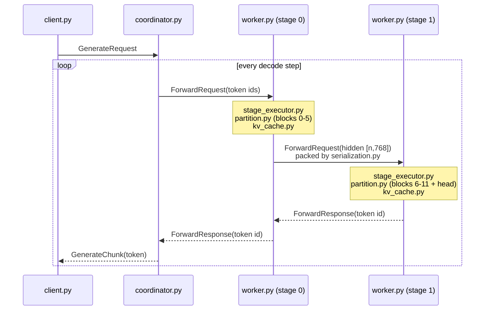
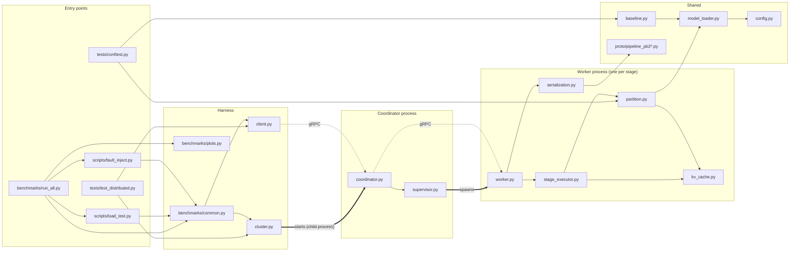

# Code walkthrough

This document goes through the repository one file at a time and explains what each file does and how data
moves through it: which function runs first, what it calls next, and what it hands to the next file.

* For *why* the system is designed this way (objectives, trade-offs, things left out), see
  [IMPLEMENTATION.md](IMPLEMENTATION.md).
* For setup, commands and results, see [README.md](README.md).

---

## Contents

1. [The life of one request, end to end](#1-the-life-of-one-request-end-to-end)
2. [Top-level files](#2-top-level-files)
3. [`pllm/` — the inference system](#3-pllm--the-inference-system)
4. [`tests/`](#4-tests)
5. [`scripts/`](#5-scripts)
6. [`benchmarks/`](#6-benchmarks)
7. [Which file calls which](#7-which-file-calls-which)

---

## 1. The life of one request, end to end

The per-file sections are easier to follow once you have seen the whole path. Here is what happens when a
client asks for 32 tokens of `"The capital of France is"`.



1. **Client sends.** [`pllm/client.py`](pllm/client.py) `generate()` opens a server-streaming
   `Generate` RPC to the coordinator.
2. **Coordinator admits.** [`CoordinatorServicer.Generate`](pllm/coordinator.py#L621) tokenises the prompt,
   validates it, and calls `Coordinator.submit()`. The request lands in the bounded **admission queue**, or
   is rejected at once with `OVERLOADED`.
3. **Scheduler batches.** [`_scheduler_loop`](pllm/coordinator.py#L253) moves the request into the
   **active set** and the **ready deque**, groups it with other ready requests into a micro-batch, and
   starts [`_run_batch`](pllm/coordinator.py#L300).
4. **Step 0 is a prefill.** [`_build_item`](pllm/coordinator.py#L292) sends the whole prompt with
   `reset=True`, `step=0`.
5. **Stage 0 computes.** [`StageServicer.Forward`](pllm/worker.py#L115) on worker 1 runs `_compute` on its
   single compute thread. [`StageExecutor.process`](pllm/stage_executor.py#L98) validates the item, creates
   a KV cache, embeds the tokens and runs blocks 0–5. The output activations are serialised and sent to
   stage 1.
6. **Stage 1 computes.** Worker 2 does the same with blocks 6–11, then applies `ln_f` and the LM head and
   takes the greedy `argmax`. It returns a token id.
7. **The reply travels back.** Stage 0 copies stage 1's result into its own reply, and the coordinator gets
   one `ForwardResponse` with the token and per-stage timings.
8. **Coordinator emits.** [`_process_response`](pllm/coordinator.py#L333) checks that the result belongs to
   this batch, attempt and step, then [`_accept`](pllm/coordinator.py#L397) appends the token, pushes a
   `GenerateChunk` to the request's event queue, and marks the request ready again.
9. **Steps 1..31 are decodes.** Each sends only the last generated token. Each stage appends one position
   to its cache. On step 31, `release_after=True` makes both workers free the cache.
10. **Finish.** [`_finish`](pllm/coordinator.py#L209) pushes a final chunk with `COMPLETED`, the full token
    list and timings. The `Generate` stream ends.

If a worker dies at any point, the heartbeat loop notices, restarts it with a higher **epoch**, and every
active request replays `prompt + generated tokens` to rebuild its caches. See
[`coordinator.py` → failure handling](#pllmcoordinatorpy).

---

## 2. Top-level files

### `baseline.py`

**Purpose:** the single-process "ground truth". It runs stock Hugging Face GPT-2 and writes
`reference_outputs.json`. Every distributed configuration is compared against that file token for token.

**How it runs** (`python baseline.py`):

1. [`main()`](baseline.py#L105) parses arguments and reads `prompts.json`.
2. [`run()`](baseline.py#L69):
   * calls `set_determinism()` (seeds, deterministic kernels, fixed thread count) from `model_loader.py`;
   * calls [`load_model()`](baseline.py#L27), which loads `GPT2LMHeadModel` in fp32 with
     `attn_implementation="eager"` and the tokenizer;
   * runs a 2-token warm-up so lazy initialisation does not distort the first prompt's timing;
   * for each prompt: tokenises, calls `greedy_generate()`, and records prompt ids, output ids, decoded
     text, per-token latency and total time.
3. [`greedy_generate()`](baseline.py#L38) is a plain loop. The first iteration feeds the whole prompt
   (prefill); each later one feeds only the previous token plus `past_key_values`. It always produces
   exactly `max_new_tokens` (no EOS stop) and picks `argmax` of the last logits. With `use_cache=False` it
   re-feeds the whole sequence every step.
4. A `meta` block is built (library versions, model commit, thread count, timings) and
   [`tokens_digest()`](baseline.py#L62) computes a SHA-256 over all `(prompt ids, output ids)` pairs.
5. The result is written to `reference_outputs.json`.

**`--check` mode** re-runs the same prompts and compares the new digest and each output list with the
stored file. Exit code 0 means byte-identical.

### `prompts.json`

A JSON list of 24 fixed prompts, from one word (`"Hello"`) up to about 90 tokens, so tests and benchmarks
cover both short and long prefills.

### `reference_outputs.json`

Output of `baseline.py`. Structure:

```json
{
  "meta":    { "model": "gpt2", "max_new_tokens": 32, "torch_threads": 4, "tokens_sha256": "...", ... },
  "prompts": [ { "id": 0, "prompt": "...", "prompt_token_ids": [...], "prompt_len": 1,
                 "output_token_ids": [...32 ids...], "output_text": "...",
                 "per_token_latency_ms": [...], "total_ms": ... }, ... ]
}
```

Tests, benchmarks and fault-injection scripts read `prompt_token_ids` as input and `output_token_ids` as the
expected answer.

### `requirements.txt`, `pytest.ini`, `.gitignore`

* `requirements.txt` pins torch, transformers (baseline only), grpcio, protobuf and the rest.
* `pytest.ini` sets `testpaths = tests` and defines the `slow` marker for end-to-end tests, so
  `pytest -m "not slow"` runs only the in-process unit tests.
* `.gitignore` excludes the venv, caches, `logs/` and temporary benchmark output.

### `Parallel_LLM_Inference_Objectives.pdf`

The assignment specification (objectives O1–O9, experiments E1–E9). The code refers to these numbers in
docstrings.

---

## 3. `pllm/` — the inference system

### `pllm/config.py`

**Purpose:** one place for defaults and configuration objects. It contains no logic beyond split parsing.

* **Constants:** repository paths (`PROMPTS_FILE`, `REFERENCE_FILE`, `LOG_DIR`), model name and revision
  (overridable through `PLLM_MODEL`), `DEFAULT_THREADS` (from `PLLM_THREADS`, default 4), ports (coordinator
  50050, stage *i* on 50051 + *i*), and `GRPC_OPTIONS` (256 MB message limit, short reconnect backoff so a
  restarted worker is reachable again quickly).
* **[`WorkerConfig`](pllm/config.py#L41):** everything a worker process needs: stage index, port, next
  stage address, epoch, queue size, cache capacity and TTL, wire dtype, artificial link delay, parent pid.
* **[`CoordinatorConfig`](pllm/config.py#L62):** admission and active limits, batching parameters
  (`max_batch_size`, `max_wait_ms`, `max_inflight_batches`), timeouts, heartbeat and recovery settings, and
  the `duplicate_dispatch` fault-injection flag.
* **[`parse_split()`](pllm/config.py#L103):** turns a split string into per-stage `[start, end)` layer
  ranges:
  * `"6"` → `[(0,6), (6,12)]`;
  * `"4,8"` → three stages;
  * a spec that does not match the stage count → even split;
  * `"auto"` → [`_balanced_split()`](pllm/config.py#L133), which tries every combination of boundaries and
    keeps the one with the smallest *largest* stage, counting the embedding on stage 0 and the LM head on
    the last stage.

### `pllm/model_loader.py`

**Purpose:** find the GPT-2 checkpoint on disk and read only the tensors a stage needs.

* [`GPT2Config.from_json()`](pllm/model_loader.py#L42) reads `config.json` and refuses non-GPT-2
  checkpoints. `params_per_layer()` counts one block's parameters, which `"auto"` splitting uses.
* [`resolve_model_dir()`](pllm/model_loader.py#L62):
  1. if the model name is a local directory, use it;
  2. otherwise try the Hugging Face cache with `local_files_only=True`;
  3. if that fails (and `HF_HUB_OFFLINE` is not set), download only the files in `MODEL_FILES`.
* [`load_tensors(model_dir, keys_filter)`](pllm/model_loader.py#L86) opens `model.safetensors` with
  `safe_open`, strips the `transformer.` prefix from each key, and loads a tensor (as fp32) only if
  `keys_filter(name)` returns true. Unwanted tensors are never read into memory.
* [`set_determinism()`](pllm/model_loader.py#L99) seeds Python, torch and NumPy, enables
  `torch.use_deterministic_algorithms(True)`, sets the torch thread count and disables autograd. The
  baseline, the tests and every worker call it, so floating-point results match across processes.
* `snapshot_commit()` returns the snapshot folder name, which is the Hub commit hash, for provenance.

### `pllm/partition.py`

**Purpose:** the GPT-2 math for a contiguous range of layers. This is where the model is actually split.

**Building a stage**

1. [`stage_ranges()`](pllm/partition.py#L38) computes embedding and head parameter counts and calls
   `parse_split()` to get each stage's layer range.
2. [`StageModule.from_pretrained()`](pllm/partition.py#L87) builds a filter (`wanted()`) that accepts:

   * `h.{i}.*` for `start <= i < end` (skipping the old `attn.bias` mask buffers);
   * `wte.weight` on the first **or** last stage (the LM head is tied to it);
   * `wpe.weight` on the first stage only;
   * `ln_f.*` on the last stage only.

   It then calls `load_tensors()` with that filter.
3. [`StageModule.__init__`](pllm/partition.py#L52) registers the tensors as frozen parameters. Each block's
   weights are stored with dots replaced by underscores (`attn_c_attn_weight`, ...). `has_embeddings` and
   `has_head` record whether this stage is first or last.

**Forward pass: [`forward_segments(x, segments)`](pllm/partition.py#L137)**

Input `x` is a `[Σnᵢ, 768]` matrix: the rows of every request in the micro-batch stacked together. Each
`SegmentInput` says how many rows belong to one request (`n_tokens`) and gives that request's past K/V per
local layer (or `None`).

For each local block:

1. `layer_norm` (ln_1) on **all rows at once**.
2. QKV projection with `_conv1d` (`torch.addmm`, same as HF `Conv1D`) on all rows at once, split into
   q, k, v.
3. **Per segment:** slice that request's rows, reshape to `[1, H, n, D]`, remember the new (k, v) for the
   cache, concatenate with the past K/V, and run [`_attention`](pllm/partition.py#L125): `q·kᵀ/√D`, a
   causal mask (only when `n > 1`) filled with `finfo.min`, softmax, `·v`.
4. Concatenate the per-segment attention outputs back into one matrix and apply the output projection and
   the residual.
5. ln_2 → MLP (`c_fc`, `gelu_new`, `c_proj`) → residual, again on all rows at once.

It returns the output rows and, per request, the *new* K/V for each local layer. The caller decides whether
to store them.

This is "selective batching": the heavy matrix multiplications are batched, and attention is done per
request, so requests of different lengths batch together without padding.

**Other helpers**

* [`embed()`](pllm/partition.py#L117): `wte[token_ids] + wpe[positions]` (stage 0 only).
* [`head()`](pllm/partition.py#L176): final layer norm plus `F.linear` with the tied embedding, giving
  logits (last stage only).
* [`load_stages()`](pllm/partition.py#L182): load all stages into one process. Used by tests and the
  in-process benchmark.
* [`PipelineStage`](pllm/partition.py#L189): a simple wrapper of `StageModule` + `KVCacheManager` that
  exposes `forward(hidden_states, request_id, step)`. `forward_batch()` gets or creates the cache, embeds
  on stage 0, runs `forward_segments`, appends the new K/V, and returns hidden rows (or last-position logits
  on the final stage). It has only basic ordering checks; the real workers use `StageExecutor` instead.

### `pllm/kv_cache.py`

**Purpose:** per-request K/V storage for one stage, plus the bookkeeping needed for ordering and
idempotency.

**Data structures**

* [`RequestCache`](pllm/kv_cache.py#L29): one per request on this stage.
  * `layers`: one `(K, V)` pair per **local** layer, each `[1, heads, seq_len, head_dim]`;
  * `length`: number of cached positions;
  * `attempt`, `last_step`, `last_output`: the idempotency key of the last applied step and its result;
  * timestamps for TTL eviction.
* [`Tombstone`](pllm/kv_cache.py#L48): what is remembered after a cache is freed (attempt, last step, last
  output, reason), so late messages can be rejected or a final-step retry answered.

**[`KVCacheManager`](pllm/kv_cache.py#L57) operations**

* `get(request_id)`: look up and refresh `last_access`.
* [`create(request_id, attempt)`](pllm/kv_cache.py#L91): drop any old cache and tombstone for the id. If at
  capacity, evict expired caches first; if still full, raise `CacheFullError`. Otherwise create an empty
  `RequestCache`.
* [`release(request_id, reason)`](pllm/kv_cache.py#L103): remove the cache and leave a tombstone.
* [`evict_expired()`](pllm/kv_cache.py#L112): release every cache idle for longer than `ttl_s`.
* `_add_tombstone()`: keeps tombstones in an LRU `OrderedDict` capped at 4096 entries.
* [`append(cache, layer, k, v)`](pllm/kv_cache.py#L132): `torch.cat` new K/V onto the past along the
  sequence dimension.

### `pllm/serialization.py`

**Purpose:** convert tensors to and from the protobuf `Tensor` message without losing any bits.

* [`tensor_to_proto(t, wire_dtype)`](pllm/serialization.py#L34):
  1. optionally cast to `wire_dtype` (fp16 compression; lossy);
  2. make the tensor contiguous on CPU;
  3. view it as `uint8` and take the raw bytes. This works for every dtype, including bfloat16;
  4. return `Tensor(shape, dtype name, data)`.
* [`proto_to_tensor(msg, out_dtype)`](pllm/serialization.py#L44): `torch.frombuffer` over a copy of the
  bytes, reshape, and optionally cast back (for example fp16 → fp32).
* The module asserts the machine is little-endian, because the wire format is.

### `pllm/proto/pipeline.proto` and generated files

**Purpose:** the wire protocol. `pipeline_pb2.py`, `pipeline_pb2.pyi` and `pipeline_pb2_grpc.py` are
generated from it by `scripts/gen_proto.sh` and committed, so users do not need `grpcio-tools`.

Two services:

| Service                | RPC           | Used by                           | What it carries                                                                                                |
| ---------------------- | ------------- | --------------------------------- | -------------------------------------------------------------------------------------------------------------- |
| `StageService`       | `Forward`   | coordinator → stage 0 → stage 1 | `ForwardRequest{stage_epochs, batch_id, items[]}` → `ForwardResponse{results[], timings[], worker_epoch}` |
|                        | `Health`    | coordinator heartbeats            | stage, epoch, pid, queue depth, cached requests                                                                |
|                        | `Release`   | coordinator on cancel/timeout     | list of request ids to free                                                                                    |
|                        | `Stats`     | coordinator, benchmarks           | JSON counters (optional reset)                                                                                 |
|                        | `Configure` | benchmarks (E9)                   | JSON: link delay, bandwidth, wire dtype                                                                        |
| `CoordinatorService` | `Generate`  | clients                           | `GenerateRequest` → stream of `GenerateChunk` (one per token, then a final one)                           |
|                        | `Cancel`    | clients                           | request id                                                                                                     |
|                        | `Stats`     | clients, benchmarks               | JSON coordinator stats (+ worker stats)                                                                        |

Key messages:

* **`StageItem`**: one request inside a micro-batch: `request_id`, `step`, `attempt`, flags `reset`,
  `use_cache`, `release_after`, and either `token_ids` (stage 0 input) or `hidden` (later stages).
* **`ItemResult`**: per-item status (`ItemStatus` enum), `token_id` (last stage), `replayed` flag and a
  detail string.
* **`StageTiming`**: per-stage queue, compute, (de)serialisation and downstream time, plus bytes in and out.
* **`ItemStatus`** values (`OK`, `STALE_EPOCH`, `FUTURE_EPOCH`, `STALE_STEP`, `OUT_OF_ORDER`,
  `STALE_ATTEMPT`, `UNKNOWN_REQUEST`, `REQUEST_CLOSED`, `CACHE_FULL`, `QUEUE_FULL`,
  `DOWNSTREAM_UNAVAILABLE`, `INTERNAL_ERROR`) are how workers tell the coordinator what went wrong.
* **`RequestStatus`** (`RUNNING`, `COMPLETED`, `OVERLOADED`, `TIMEOUT`, `CANCELLED`, `FAILED`, `INVALID`)
  is what clients see.

### `pllm/stage_executor.py`

**Purpose:** the stateful core of a worker: validate a micro-batch, run it, update caches. It has no gRPC
code, so its rules are unit-tested directly in `tests/test_kv_cache.py`.

**[`process(stage_epochs, items, decoded_hidden)`](pllm/stage_executor.py#L98)**, step by step:

1. Create an `ItemOutcome` per item.
2. **Epoch check** ([`check_epoch`](pllm/stage_executor.py#L88)): compare the message's epoch for *this*
   stage with the worker's epoch. If lower → every item gets `STALE_EPOCH`; if higher → `FUTURE_EPOCH`.
   Return immediately; nothing is computed.
3. Evict expired caches.
4. For each item:
   * the same request twice in one batch → `STALE_STEP`;
   * run [`_validate`](pllm/stage_executor.py#L158) (below). It returns a status, the cache to use, and
     possibly a stored output to replay;
   * replay → answer from the stored output, set `replayed=True`, do not compute;
   * non-OK status → record the rejection;
   * OK → build an `ExecItem` with token ids (stage 0) or the already-deserialised hidden tensor (later
     stages).
5. If anything is left to run, call `_execute`. On any exception, release the caches of every item in the
   batch and mark them `INTERNAL_ERROR`, so a half-updated cache is never kept.
6. Update `stats` (batches, items, busy time).

**[`_validate(item)`](pllm/stage_executor.py#L158)** decides what to do with one item:

| Situation                                      | Result                                        |
| ---------------------------------------------- | --------------------------------------------- |
| `use_cache=False`                            | OK, stateless full recompute                  |
| no cache, tombstone matches`(attempt, step)` | replay stored final output                    |
| no cache, tombstone says completed/released    | `REQUEST_CLOSED`                            |
| no cache, not a reset                          | `UNKNOWN_REQUEST` (coordinator must replay) |
| no cache, reset                                | create cache (or`CACHE_FULL`)               |
| item attempt < cache attempt                   | `STALE_ATTEMPT`                             |
| item attempt > cache attempt                   | reset → rebuild; else`UNKNOWN_REQUEST`     |
| same attempt,`step == last_step`             | duplicate → replay`last_output`            |
| same attempt,`step < last_step`              | `STALE_STEP`                                |
| same attempt, reset for a later step           | rebuild                                       |
| same attempt,`step > last_step + 1`          | `OUT_OF_ORDER`                              |
| same attempt,`step == last_step + 1`         | OK, execute                                   |

**[`_execute(to_run, outcomes)`](pllm/stage_executor.py#L204)**:

1. Per item: on stage 0, embed tokens at positions `cache.length .. cache.length + n`; otherwise use the
   hidden tensor. Collect a `SegmentInput` with the past K/V.
2. Concatenate all rows and call `StageModule.forward_segments` once.
3. On the last stage, take the last row of each item, run `head()`, and `argmax` to a token id.
4. Per item: set the output (token id or a clone of the hidden rows), append the new K/V to the cache,
   advance `length` and `last_step`, store `last_output`, and release the cache if `release_after` is set.

### `pllm/worker.py`

**Purpose:** the worker process. It wraps one `StageExecutor` in a gRPC server and forwards activations to
the next stage.

**Startup ([`serve()`](pllm/worker.py#L232) via `main()`):**

1. Parse CLI arguments into a `WorkerConfig`. If `--epoch` is omitted, use the current time in ms.
2. `set_determinism()`, resolve the model dir, compute this stage's layer range, and load the
   `StageModule` with only its weights.
3. Create a `StageServicer`, start an `grpc.aio` server on the port, and log `READY`.
4. Install SIGINT/SIGTERM handlers. If `--parent-pid` is set, a background task checks every second that
   the parent (the coordinator) is still alive and shuts the worker down if not.

**[`StageServicer`](pllm/worker.py#L55) state:** a `StageExecutor`, a `ThreadPoolExecutor(max_workers=1)`
(the single compute thread), a gRPC stub to the next stage (if any), the `pending` counter for
backpressure, and counters for stats.

**A `Forward` call ([`Forward`](pllm/worker.py#L115)):**

1. Count `bytes_in`. If `pending >= queue_size`, answer immediately with `QUEUE_FULL` for every item
   (backpressure; nothing is queued).
2. `pending += 1`, then run [`_compute`](pllm/worker.py#L85) on the compute thread:
   1. deserialise each item's `hidden` tensor to fp32 (stages > 0);
   2. call `executor.process(...)`;
   3. if there is a next stage, build a new `ForwardRequest` with the same epochs and batch id, containing
      only the items that succeeded, each carrying its output hidden tensor serialised in the wire dtype;
   4. return outcomes, the next request and a `StageTiming` (queue, deserialise, compute, serialise).
3. `pending -= 1`. **The compute thread is now free**, so the next batch can start computing here while
   this one goes downstream. This is what makes pipelining work.
4. Convert outcomes to `ItemResult`s (the last stage fills `token_id`).
5. If there is a next request, [`_forward_downstream`](pllm/worker.py#L163):
   * count bytes out;
   * optionally `sleep` for the injected link delay or simulated bandwidth;
   * call the next stage with `timeout = min(downstream_timeout, caller's remaining deadline)`;
   * on an RPC error, return `None`.
6. Merge the downstream results into this stage's results by request id. If an item is missing from the
   downstream reply, it becomes `DOWNSTREAM_UNAVAILABLE`. Append downstream timings to this stage's.
7. Return one `ForwardResponse` with `worker_epoch`.

**Other RPCs:**

* `Health`: stage, epoch, pid, queue depth, cached requests. It runs on the event loop, so it answers even
  while a batch is computing.
* `Release`: frees caches, run on the compute thread so it never races with `process`.
* `Stats`: JSON with parameter bytes, RSS, utilisation (`busy_s / wall_s`), queue maxima, bytes, cache
  size, rejections, replays. `{"reset": true}` resets the counters afterwards.
* `Configure`: changes link delay, bandwidth or wire dtype at runtime (used by E9 and the fp16 run).

### `pllm/supervisor.py`

**Purpose:** start, kill and restart local worker processes for the coordinator.

* [`spawn(stage, epoch)`](pllm/supervisor.py#L42) builds the command line
  `python -m pllm.worker --stage .. --port base+stage --epoch .. --parent-pid <coordinator pid>` (plus
  `--next-addr` for all but the last stage), sets `PYTHONPATH` and `HF_HUB_OFFLINE=1`, and redirects
  output to `logs/stage{N}_epoch{E}.log`.
* [`start_all()`](pllm/supervisor.py#L65) starts stages in reverse order, so each stage's downstream
  already exists when it starts.
* `kill()` sends a signal (SIGKILL by default) and waits; [`restart()`](pllm/supervisor.py#L88) is
  `kill` + `spawn` with a new epoch.
* `stop_all()` sends SIGTERM to all, waits, then kills stragglers and closes log files.

### `pllm/coordinator.py`

**Purpose:** the client-facing server and the brain of the system: admission, scheduling, ordering,
failure detection and recovery.

**Request state ([`Request`](pllm/coordinator.py#L60))**

Each request has an internal uuid (used on the wire, never reused), the client's id, prompt, generated
tokens, `next_step`, `attempt`, `needs_reset` (true at first, because step 0 is a prefill),
`in_flight_batch`, an `asyncio.Queue` of output chunks, timestamps, a deadline and retry counters.
[`mark_reset()`](pllm/coordinator.py#L85) sets `needs_reset` and increments `attempt`.

**Startup ([`serve()`](pllm/coordinator.py#L676) → [`Coordinator.start()`](pllm/coordinator.py#L139))**

1. Make sure the weights are downloaded (workers run offline), load the tokenizer.
2. If no `--worker-addrs` were given, create a `WorkerSupervisor` and spawn all workers with epoch 1.
3. Open a channel and stub to each stage and poll `Health` until every stage is up with the expected epoch.
4. Start three background tasks: `_scheduler_loop`, `_health_loop` and `_reaper_loop`.
5. Start the gRPC server and print `COORDINATOR READY` (which `LocalCluster` waits for).

**Admission**

* [`Generate`](pllm/coordinator.py#L621) validates input (prompt not empty, `prompt + max_new_tokens <= 1024`, request id not in use) and calls [`submit()`](pllm/coordinator.py#L175). If the admission deque is
  full, `submit` raises `OverloadedError` and the client gets one final `OVERLOADED` chunk.
* Otherwise `Generate` loops on `r.events.get()` and yields each chunk until the final one. Its `finally`
  block cancels the request if the client went away early.
* [`_admit()`](pllm/coordinator.py#L190), called at the top of every scheduler iteration, moves requests
  from the admission deque into `active` (up to `max_active`) and appends them to `ready`.

**Scheduling ([`_scheduler_loop`](pllm/coordinator.py#L253))**

Each iteration:

1. Admit, then drop finished or already-in-flight requests from the front of `ready`.
2. Wait (up to 50 ms or until woken) if a stage is recovering, nothing is ready, or
   `max_inflight_batches` batches are already in flight.
3. If fewer than `max_batch_size` are ready and more could become ready soon (other active requests are in
   flight, or some are waiting for admission), wait up to `max_wait_ms` for the batch to fill. A lone
   request does not wait.
4. Pop up to `max_batch_size` ready requests, give them a new batch id, set `in_flight_batch`, and start
   `_run_batch` as a task.

**Running a batch**

* [`_build_item(r)`](pllm/coordinator.py#L292): if the request needs a reset (first step, or after
  recovery) or the cache is off, send `prompt + generated`; otherwise send only the last generated token.
  Set `reset`, `use_cache`, and `release_after` on the last step.
* [`_run_batch`](pllm/coordinator.py#L300): snapshot the current epochs, send `Forward` to stage 0 with
  `rpc_timeout`, decrement `inflight`, call `_process_response`, and wake the scheduler. With
  `--duplicate-dispatch` it then sends the same batch again ([`_send_duplicate`](pllm/coordinator.py#L322))
  to test idempotency.

**Handling the reply ([`_process_response`](pllm/coordinator.py#L333))**

1. Record batch timings and byte counts (`_record_batch`).
2. If the RPC failed **or** the epochs changed while the batch was in flight, discard everything and retry
   each request with backoff (`_retry_after_connectivity_failure`, 20–250 ms; this does not use up the
   retry budget).
3. For each `ItemResult`:
   * ignore it if the request is done, belongs to a different batch, or this is a duplicate dispatch;
   * ignore it if `step` or `attempt` do not match what the request expects;
   * `OK` → [`_accept`](pllm/coordinator.py#L397): append the token, record timing, push a
     `GenerateChunk`, then either finish (`COMPLETED`) or mark ready again;
   * connectivity statuses (`DOWNSTREAM_UNAVAILABLE`, `STALE_EPOCH`, `FUTURE_EPOCH`) → retry with backoff;
   * otherwise count a retry; past `max_retries` → `FAILED`;
   * "worker lost the cache" statuses (`UNKNOWN_REQUEST`, `REQUEST_CLOSED`, `STALE_ATTEMPT`,
     `STALE_STEP`, `OUT_OF_ORDER`) → `mark_reset()` and make ready (the next item is a replay);
   * other transient statuses (`QUEUE_FULL`, `CACHE_FULL`, `INTERNAL_ERROR`) → exponential backoff, then
     ready.
4. Any request missing from the reply is made ready again.

**Failure detection and recovery**

* [`_health_loop`](pllm/coordinator.py#L460) pings every stage every `heartbeat_interval_s` (100 ms) with a
  250 ms deadline. A reply with the expected epoch refreshes `last_heartbeat`. If a stage has been silent
  for more than `failure_timeout_s` (600 ms), or (with external workers) answers with a *higher* epoch,
  `_recover(stage)` starts.
* [`_recover(stage)`](pllm/coordinator.py#L479):
  1. add the stage to `_recovering` (the scheduler pauses);
  2. set `epochs[stage] = -1`, so any response from the old incarnation fails the epoch check;
  3. `mark_reset()` every active request and reset its retry count;
  4. supervised mode: `supervisor.restart(stage, old_epoch + 1)` and wait until `Health` reports the new
     epoch. External mode: wait until something answers with a higher epoch;
  5. on success, install the new epoch, record a recovery event with timestamps, and resume scheduling;
  6. if the recovery deadline (30 s) passes, fail all active and queued requests with `FAILED`.
* Each request's next item is now a replay of `prompt + generated` with the new attempt number. Both
  stages rebuild their caches. When the replay's token is accepted, [`_replay_done`](pllm/coordinator.py#L543)
  marks it complete in the recovery event, which then gets detection, restart and replay durations.

**Housekeeping**

* [`_reaper_loop`](pllm/coordinator.py#L562) runs every 50 ms: finishes requests past their deadline with
  `TIMEOUT`, and requests stuck recovering past the recovery deadline with `FAILED`.
* [`_finish()`](pllm/coordinator.py#L209) is the single exit point for every request: it removes the
  request from all structures, pushes the final chunk, updates counters, and (for anything other than
  `COMPLETED`, where workers already freed the cache) calls `Release` on every stage in the background.
* [`stats()`](pllm/coordinator.py#L575) returns config, epochs, queue depths and maxima, counters, mean
  batch size, recovery events, RSS and worker pids; optionally includes each worker's `Stats` and, on reset,
  the per-batch log used by the benchmark breakdown.

### `pllm/client.py`

**Purpose:** a small async client library and CLI.

* [`generate(stub, ...)`](pllm/client.py#L54) sends a `GenerateRequest` and iterates the stream. For each
  token chunk it appends the token, records the client-side arrival time and calls `on_token`. On the final
  chunk it stores status, detail, server timings and the full token list. `cancel_after=N` cancels the
  stream after N tokens. RPC errors become `RPC_ERROR` or `CANCELLED`.
* `GenerateResult` computes `ttft_ms`, `itl_ms` (inter-token gaps) and `latency_ms` from those arrival
  times. Benchmarks use these numbers.
* [`get_stats(addr, reset, workers)`](pllm/client.py#L93) calls the coordinator's `Stats` RPC.
* CLI: `python -m pllm.client --prompt "..."` prints tokens as they arrive, then a status line;
  `--stats` prints the JSON stats.

### `pllm/cluster.py`

**Purpose:** start a whole cluster from Python for tests, benchmarks and scripts.

* [`LocalCluster.start()`](pllm/cluster.py#L37) runs `python -m pllm.coordinator --port P --worker-base-port P+1 <extra args>` as a child process (the coordinator then spawns the workers). A
  background thread copies its output to `logs/<name>.log` and sets an event when it sees
  `COORDINATOR READY`. Startup fails if the process exits or the timeout passes.
* `stop()` sends SIGTERM (the coordinator then stops its workers), and kills after 15 s.
* Used as a context manager: `with LocalCluster(port=..., extra=[...]) as c: ...`.
* Helpers: `stats()` / `astats()`, `worker_pid(stage)` (from coordinator stats), `worker_addr(stage)`.
  `load_reference()` reads `reference_outputs.json`.

### `pllm/metrics.py`

**Purpose:** small numeric helpers.

* `percentile(values, q)`: linear-interpolated percentile; NaN for empty input.
* `summarize(values, prefix)`: `{mean, p50, p95, p99, n}` with key prefixes, used for TTFT, ITL and latency.
* `inter_token_gaps(times)` and a named `Counter` type used by the coordinator.

### `pllm/__init__.py`, `pllm/proto/__init__.py`

Empty package markers.

---

## 4. `tests/`

Run with `python -m pytest` (everything) or `python -m pytest -m "not slow"` (unit tests only).

### `tests/conftest.py`

Session-wide fixtures, built once and shared:

* `_determinism` (autouse): calls `set_determinism()` so tests match the reference.
* `model_dir`, `reference` (parsed `reference_outputs.json`), `hf_model` (the baseline HF model), `stages`
  (two `StageModule`s split at 6).
* `_no_grad` (autouse): wraps each test in `torch.inference_mode()`.

### `tests/test_baseline.py`

* The reference file has ≥ 20 prompts of varied length, every output has `max_new_tokens` tokens, and the
  stored digest is correct.
* Re-running `greedy_generate` gives byte-identical tokens.

### `tests/test_partition.py`

* `split_logits()` runs a full sequence through stage 0 then stage 1 without caches. Its logits must be
  within `1e-5` of the HF model's for every prompt and position, with identical argmax.
* Generation through two `PipelineStage`s with KV caches reproduces every reference token.
* Other splits (`"3"`, `"9"`, three stages, `"auto"` with 2 and 4 stages) give the same logits.
* Each stage holds about half the blocks (and about 2/3 of the bytes, because of the tied embedding), the
  two stages are balanced, and stage 1 has no `wpe`.

### `tests/test_serialization.py`

* Bit-exact round trip through real protobuf encoding for 9 dtypes × 4 shapes (including empty).
* Special values (±0, ±inf, NaN, denormals) and non-contiguous input survive.
* Byte counts match `shape × itemsize`; fp16 halves them and stays close to the original.

### `tests/test_kv_cache.py`

Uses a `Pipe` helper: two `StageExecutor`s wired together in one process, so the worker rules are tested
without gRPC.

* Cache on, cache off and the reference agree; cache on is faster.
* Two interleaved requests, in alternating order and in single or shared batches, never mix.
* Mixed prefill and decode items in one batch still match the reference (selective batching).
* `OUT_OF_ORDER` and `STALE_STEP` are rejected and leave the cache unchanged.
* A duplicate step is answered with `replayed=True` and the same token, without changing cache length.
* A step applied only on stage 0 is safely retried through both stages.
* After a simulated stage-1 crash: `UNKNOWN_REQUEST`, then a replay under attempt 1 rebuilds the cache, and
  a late attempt-0 message gets `STALE_ATTEMPT`.
* Epoch fencing (`STALE_EPOCH`, `FUTURE_EPOCH`), release and `REQUEST_CLOSED`, final-step retry from the
  tombstone, cache capacity (`CACHE_FULL`) and TTL eviction.

### `tests/test_distributed.py` (marked `slow`)

Real processes and gRPC on localhost, through `LocalCluster`:

* sequential requests and 50 concurrent requests match the reference; queues stay within bounds, every
  worker cache is freed afterwards, and mean batch size > 1.5;
* cancellation after 3 tokens frees worker caches; a tiny timeout gives `TIMEOUT`;
* SIGKILL of stage 1 and stage 0 mid-generation: every request still matches the reference exactly, the
  epoch increased, and the recovery event says `recovered`;
* a message with an old epoch sent straight to a worker gets `STALE_EPOCH`;
* `--duplicate-dispatch` produces no duplicate tokens and discards the duplicate results;
* overload (admission queue 4) gives only `COMPLETED` or `OVERLOADED`, with nothing hanging;
* `--no-kv-cache` cluster still matches the reference.

---

## 5. `scripts/`

### `scripts/demo.sh`

A terminal demo in three acts:

1. start the coordinator in the background and wait for `COORDINATOR READY`; print epochs and worker pids;
2. stream a normal generation with the client CLI;
3. send 60 simultaneous requests against an admission queue of 8 and print how many were rejected and how
   quickly;
4. start a 120-token generation, `kill -9` worker 2 one second in, and print the new epochs and the recovery
   timings from `--stats`.

### `scripts/load_test.py` (experiment E5)

1. Start a dedicated cluster (admission 16, active 16) or use `--addr`.
2. Fire `--requests` requests open-loop at `--rate` per second.
3. In parallel, a sampler calls `Stats` every 100 ms and records admission depth, active count, in-flight
   batches, rejections, completions, per-worker queue depth, cached requests and RSS.
4. Write `benchmarks/results/<tag>_timeseries.csv` and `<tag>_summary.json` (status counts, rejection rate
   and latency, max queue depths vs capacities, RSS range, goodput).
5. Print `PASS` if every queue stayed within its bound, nothing hung, and every completed request matched
   the reference.

### `scripts/fault_inject.py` (experiments E6, E7, E8)

* **`kill` mode** ([`kill_run`](scripts/fault_inject.py#L39)): start a workload of concurrent requests,
  poll stats until a set fraction of tokens is generated, SIGKILL the chosen worker, wait for the workload
  to finish, then compare every result with the reference and count duplicate or missing tokens. It reads
  the coordinator's recovery event and converts its timestamps to "ms after the kill" (detection, restart,
  replay, total). After the first repetition it also calls `inject_stale` with the pre-crash epochs and
  expects `STALE_EPOCH`. Writes `e6_e7_recovery.csv`, `e6_e7_timeline.csv` (per-token arrival times) and
  `e6_e7_marks.csv`.
* **`stale` mode** (E8):
  1. kill stage 1 while idle and wait for the new epoch, then inject an old-epoch message;
  2. `inject_duplicates`: talk to stage 0 directly, send each decode step twice, and check that every
     duplicate is answered with `replayed=True` and the same token, and that a late old step is rejected;
  3. `duplicate_dispatch_run`: run a cluster with `--duplicate-dispatch` and check there are no duplicate
     tokens.
* Results are merged into `benchmarks/results/e6_e8_fault_summary.json`; the script prints `PASS` or
  `FAIL`.

### `scripts/gen_proto.sh`

Runs `grpc_tools.protoc` on `pllm/proto/pipeline.proto` to regenerate the three committed binding files.
Needed only when the `.proto` changes.

---

## 6. `benchmarks/`

### `benchmarks/run_all.py`

**Purpose:** one command that runs every experiment and regenerates every plot.

`python -m benchmarks.run_all [--quick] [--reps N] [--only e1,e3,...]`:

1. Write `results/env.json` (Python, torch, CPU count, threads, reps).
2. **Baseline** ([`run_baseline`](benchmarks/run_all.py#L54)): HF model in this process, timing each prompt.
   **Split in-process** ([`run_split_inprocess`](benchmarks/run_all.py#L79)): both stages in one process,
   no RPC, to isolate the network cost. → `baseline.csv`.
3. Each experiment starts its own `LocalCluster` with specific flags, warms up, then calls
   [`measured()`](benchmarks/run_all.py#L44): reset stats → run the workload → read stats with reset →
   combine client metrics with cluster metrics.
   * **E1** single request at a time → `e1_single_request.csv`;
   * **E2** KV cache on vs `--no-kv-cache`, plus per-prompt rows for ITL vs prompt length →
     `e2_kv_cache.csv`;
   * **E3** concurrency sweep for unbatched (`batch 1, inflight 1`) vs micro-batched (`batch 8, inflight 2`) → `e3_concurrency.csv`;
   * **E4** batch size 1–16 × inflight 1/2 at concurrency 32 → `e4_batch_sweep.csv`;
   * **E5** → `scripts/load_test.py`; **E6/E7** → `scripts/fault_inject.py kill`; **E8** →
     `scripts/fault_inject.py stale`;
   * **E9** set stage 0's link delay with `Configure` (0–20 ms), measure single-request ITL and
     concurrency-32 throughput, with 1 and 4 batches in flight → `e9_network_delay.csv`;
   * **plen** synthetic prompts of 8–512 tokens, baseline vs distributed TTFT, ITL and bytes →
     `prompt_length.csv`;
   * **fp16** float32 vs float16 activations: exact-match rate, token accuracy, first divergence, bytes per
     token → `fp16_compression.csv`.
4. Call `benchmarks.plots.main()`.

### `benchmarks/common.py`

Shared helpers:

* paths (`results/`, `plots/`), `BENCH_PORT = 50400` so benchmark clusters never clash with a manual one;
* `write_csv` / `read_csv` (union of keys, numeric parsing);
* `entries_for(n)`: cycle through the reference prompts to get n requests;
* `cluster(name, extra)`: a `LocalCluster` with a benchmark log name;
* [`run_workload()`](benchmarks/common.py#L86): closed loop (a semaphore limits outstanding requests) or open
  loop (fixed inter-arrival time); returns results and wall time;
* [`result_metrics()`](benchmarks/common.py#L113): completed/rejected counts, correctness against the
  reference, throughput, and TTFT/ITL/latency summaries;
* [`cluster_metrics()`](benchmarks/common.py#L130): mean batch size, bytes per token, per-stage utilisation,
  RSS and max queue, plus `breakdown()`;
* [`breakdown()`](benchmarks/common.py#L149): from the batch log, mean RPC time split into compute,
  (de)serialisation, worker queueing, link delay, and the remainder (gRPC, network and event-loop overhead);
* `aggregate()`: mean and standard deviation across repetitions; `baseline_metrics()`: the same metrics from
  per-token latencies.

### `benchmarks/plots.py`

Reads the CSV/JSON files in `benchmarks/results/` and writes:

| Function                   | Input CSV                                   | Output                                               |
| -------------------------- | ------------------------------------------- | ---------------------------------------------------- |
| `plot_e1`                | `baseline.csv`, `e1_single_request.csv` | `e1_latency.png`                                   |
| `plot_e2`                | `e2_kv_cache.csv`                         | `e2_kv_cache.png`                                  |
| `plot_e3`                | `e3_concurrency.csv`, `baseline.csv`    | `e3_throughput_vs_concurrency.png`                 |
| `plot_e4`                | `e4_batch_sweep.csv`                      | `e4_batch_sweep.png`, `bottleneck_breakdown.png` |
| `plot_overload`          | `e5_overload_timeseries.csv`              | `e5_overload.png`                                  |
| `plot_recovery_timeline` | `e6_e7_timeline.csv`, `e6_e7_marks.csv` | `e6_e7_recovery_timeline.png`                      |
| `plot_e9`                | `e9_network_delay.csv`                    | `e9_network_delay.png`                             |
| `plot_plen`              | `prompt_length.csv`                       | `prompt_length_ttft.png`                           |

`summary_md()` builds `benchmarks/results/summary.md` with tables for every experiment. `main()` runs each
plot function inside `try/except`, so one missing result does not stop the rest. Run it alone with
`python -m benchmarks.plots` to redraw from existing CSVs.

### `benchmarks/__init__.py`

Empty package marker, so `python -m benchmarks.run_all` works.

---

## 7. Which file calls which



Solid arrows mean "imports / calls", thick arrows mean "starts a new OS process", and dotted arrows are gRPC
calls between processes. `config.py` and `proto/pipeline_pb2*.py` are imported almost everywhere, so only
their main users are drawn.

* **Process boundaries:** `client.py` ↔ `coordinator.py` ↔ `worker.py` (stage 0) ↔ `worker.py` (stage 1),
  all over gRPC using the messages in `pipeline.proto`.
* **Inside a worker:** `worker.py` (networking, threads) → `stage_executor.py` (rules, state) →
  `partition.py` (math) + `kv_cache.py` (storage); `serialization.py` at the edges.
* **Inside the coordinator:** `coordinator.py` (admission, scheduling, recovery) → `supervisor.py`
  (process management).
