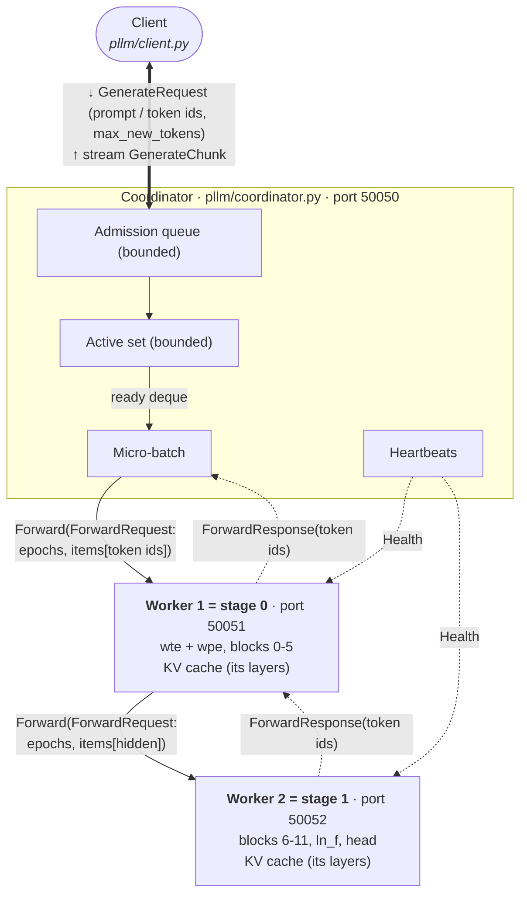

# Implementation guide

This document explains how the pipeline-parallel inference system is built, file by file, and why it is built
that way. It follows the objectives in `Parallel_LLM_Inference_Objectives.pdf` (O1 to O9) and states the
design decisions and trade-offs, including what was left out. For setup and commands, see [README.md](README.md).

---

## 1. Repository map

| File                                              | Role                                                                                                               | Objective      |
| ------------------------------------------------- | ------------------------------------------------------------------------------------------------------------------ | -------------- |
| `baseline.py`                                   | Single-process Hugging Face GPT-2 greedy baseline; writes and checks`reference_outputs.json`                     | O1             |
| `prompts.json`                                  | 24 fixed prompts, from 1 to about 90 tokens long                                                                   | O1             |
| `reference_outputs.json`                        | Reference token IDs, per-token latency and total runtime. Generate it with`python baseline.py`, then commit it   | O1             |
| `pllm/config.py`                                | Defaults, ports, gRPC options,`WorkerConfig`, `CoordinatorConfig`, `parse_split()`                           | all            |
| `pllm/model_loader.py`                          | Finds or downloads the checkpoint, loads only selected tensors, sets determinism flags                             | O1, O2         |
| `pllm/partition.py`                             | `StageModule` (the GPT-2 math for a range of layers), `PipelineStage.forward(hidden_states, request_id, step)` | O2             |
| `pllm/kv_cache.py`                              | `KVCacheManager`: per-request KV cache with a capacity cap, TTL eviction and tombstones                          | O4             |
| `pllm/stage_executor.py`                        | Worker logic: epoch, attempt and step validation, idempotent replays, micro-batch execution                        | O4, O7         |
| `pllm/serialization.py`                         | Lossless tensor ↔ protobuf conversion                                                                             | O3             |
| `pllm/proto/pipeline.proto`                     | Wire protocol (generated bindings`pipeline_pb2*.py` are committed)                                               | O3             |
| `pllm/worker.py`                                | gRPC stage server: bounded input queue, single compute thread, forwarding, delay injection, stats                  | O3, O5, O6, E9 |
| `pllm/coordinator.py`                           | Client-facing server: admission control, micro-batching scheduler, ordering, heartbeats, recovery                  | O3, O5, O6, O7 |
| `pllm/supervisor.py`                            | Spawns, kills and restarts worker processes with increasing epochs                                                 | O7             |
| `pllm/client.py`                                | Async client library and CLI that streams tokens                                                                   | O3, O5         |
| `pllm/cluster.py`                               | `LocalCluster`: starts a coordinator process (which spawns the workers) for tests and benchmarks                 | tests, O8      |
| `pllm/metrics.py`                               | Percentiles and summaries                                                                                          | O8             |
| `tests/`                                        | Unit tests (baseline, partition, serialisation, KV cache, ordering, epochs) and end-to-end tests                   | O1 to O7       |
| `scripts/load_test.py`                          | Overload test that produces a queue-depth, rejection and memory time series                                        | O5, E5         |
| `scripts/fault_inject.py`                       | SIGKILL worker tests, stale-epoch injection and duplicate injection                                                | O7, E6 to E8   |
| `scripts/demo.sh`                               | Terminal demo: normal generation, overload, then a worker kill followed by recovery                                | O9             |
| `benchmarks/run_all.py`                         | One command that runs every experiment and regenerates every plot                                                  | O8             |
| `benchmarks/common.py`, `benchmarks/plots.py` | Workload and metric helpers; plots plus`results/summary.md`                                                      | O8             |

---

## 2. Architecture

Each decode step follows **Coordinator → Worker 1 → Worker 2 → Coordinator**. The coordinator calls
`Forward` on stage 0. Stage 0 computes its layers and calls `Forward` on stage 1 with the activations. Stage 1
computes, picks the greedy token, and the reply comes back up the same chain. Each component is its own OS
process with its own port: coordinator 50050, worker 1 on 50051, worker 2 on 50052.

---

## 3. O1: baseline and reference outputs (`baseline.py`)

* `load_model()` loads `GPT2LMHeadModel` with `attn_implementation="eager"` in fp32. Eager attention is used
  because it is a plain chain of matmul, scale, mask and softmax operations that `pllm/partition.py`
  reproduces operation for operation. That makes the split model match the baseline numerically.
* `greedy_generate()` is an explicit loop: a prefill call, then one decode call per token, reusing
  `past_key_values`. It always generates exactly `max_new_tokens`, with no early stop at EOS, so every system
  produces sequences of the same length. It times each token. Token 0 is the prefill latency, which is the
  time to first token.
* `set_determinism()` in `pllm/model_loader.py` seeds Python, NumPy and torch, calls
  `torch.use_deterministic_algorithms(True)`, disables autograd and fixes the number of torch threads. The
  thread count matters: matmul reduction order can depend on it, so the baseline and every worker use the
  same value (`PLLM_THREADS`, default 4).
* The output file stores, for each prompt: prompt token IDs, output token IDs and text, per-token latency
  and total time. The `meta` block stores library versions, the Hub commit of the checkpoint, the thread
  count and `tokens_sha256`, a digest of all token sequences. `python baseline.py --check` re-runs the
  baseline and compares digests. That check is the byte-identical acceptance criterion, and
  `tests/test_baseline.py` runs it as well.

## 4. O2: layer partitioning (`pllm/partition.py`, `pllm/model_loader.py`)

**Loading only the stage's weights.** `StageModule.from_pretrained()` passes a key filter to
`load_tensors()`, which opens `model.safetensors` with `safe_open` and reads only matching tensors:

* blocks `h.{start}` to `h.{end-1}`;
* `wte` and `wpe` if the stage holds the embeddings (stage 0);
* `ln_f` and `wte` if the stage holds the head (last stage). GPT-2 ties the LM head to the token embedding,
  so the last stage needs its own copy.

The full Hugging Face model is never instantiated in a worker. This also avoids importing `transformers`
there, which keeps worker restarts fast (see O7).

**Memory footprint.** Each worker reports `param_bytes` and RSS through its `Stats` RPC.
`tests/test_partition.py::test_each_stage_holds_about_half_the_weights` checks the balance. Each stage holds 6
of the 12 blocks, which is exactly half of the transformer weights. Because of the tied embedding, the
147 MiB `wte` matrix is needed at both ends, so each stage holds about 2/3 of the full checkpoint rather than
1/2. The totals are about 313 MiB for stage 0 and 310 MiB for stage 1, against 475 MiB for the full model.
This is an inherent cost of splitting a weight-tied model. An alternative would be to send the final hidden
state back to stage 0 for the LM head, which costs an extra network hop on every token. That option was
rejected.

**The forward pass.** `StageModule.forward_segments(x, segments)` re-implements GPT-2 for its own layer
range:

* `_conv1d` uses `torch.addmm(bias, x, W)`, as HF `Conv1D` does;
* `gelu_new` uses the same tanh expression as `NewGELUActivation`;
* `_attention` uses eager attention: `q·kᵀ / sqrt(d)`, a causal mask filled with `finfo.min`, softmax, then
  `·v`, with q, k and v shaped `[1, H, T, D]` exactly as in HF.

**Selective batching.** A micro-batch is a list of *segments*. Each segment is one request, with `n_i` new
tokens and its own past KV. The segments' rows are concatenated into one `[Σn_i, 768]` matrix for every
row-wise operation: layer norms, the QKV projection, the output projection and the MLP. Those are the
FLOP-heavy parts, and they now run as one large GEMM. Attention, the only operation that mixes positions, is
computed separately for each segment against that request's own cache. As a result:

* requests with different prompt and cache lengths batch together with **no padding and no attention mask**;
* a prefill (many rows) and decodes (one row each) can share a micro-batch;
* outputs equal unbatched outputs. `test_mixed_prefill_and_decode_batch_matches_reference` checks this.

**The required interface.** `PipelineStage` wraps a `StageModule` and a `KVCacheManager` and provides
`forward(hidden_states, request_id, step)`. For stage 0, `hidden_states` is the token-ID tensor, because the
embedding lives in stage 0. The last stage returns logits. `tests/test_partition.py` checks that:

* split versus full logits agree within `1e-5` for every prompt and position, and the greedy tokens match;
* KV-cached generation through the two stages reproduces the reference tokens;
* other partitions (`"3"`, `"9"`, three stages `"4,8"`, `"auto"` with four stages) produce the same logits.
  `parse_split("auto")` in `pllm/config.py` picks boundaries that minimise the largest stage's parameter
  count, counting the embedding on the first stage and the head on the last. This covers the stretch goal
  of N stages with memory-balanced assignment.

## 5. O3: RPC activation transfer (`pllm/proto/pipeline.proto`, `pllm/serialization.py`, `pllm/worker.py`)

**Schema.** `Tensor {shape, dtype, data}` carries raw little-endian bytes. A `ForwardRequest` carries:

* `stage_epochs`: the epoch the sender believes each stage has;
* `batch_id`;
* a list of `StageItem`s, one per request in the micro-batch, each with:
  * `request_id`, `step` and `attempt`;python -m pytest -m "not slow" -spython -m pytest -m "not slow" -s
  * the flags `reset`, `use_cache` and `release_after`;
  * either `token_ids` (input to stage 0) or `hidden` (input to later stages).

The reply is a `ForwardResponse` with one `ItemResult` per item: status, token, `replayed` flag and a
detail string. It also carries a list of `StageTiming` records, one per stage, with queue, compute,
serialisation, downstream time and bytes. Every message therefore carries the
`(request_id, step, worker_epoch)` triple that the specification requires.

**Serialisation.** `tensor_to_proto()` reinterprets the contiguous tensor as `uint8` and copies the bytes.
This works for every dtype, including bfloat16, which has no NumPy equivalent. `proto_to_tensor()` uses
`torch.frombuffer`. `tests/test_serialization.py` checks bit-exact round trips through real protobuf
encoding for 9 dtypes and 4 shapes, and also for NaN, ±inf, -0.0, denormals and non-contiguous inputs.
Activations travel as fp32 by default. `--activation-dtype float16` is the optional compression stretch
goal: it halves the bytes but is lossy.

**Bytes accounting.**

* Workers count `bytes_in` and `bytes_out` (serialised message sizes) and `activation_bytes_out` (raw tensor
  bytes).
* Every `StageTiming` reports `bytes_out` for its hop.
* The coordinator adds up `wire_bytes` (all hops, including protobuf framing) and `activation_bytes`. It
  attributes them to requests in proportion to their tokens in each batch. The benchmarks report both per
  token and per request.

**Deadlines.** Every RPC has a timeout:

* coordinator to stage 0: `--rpc-timeout`, default 10 s;
* stage to next stage: `min(downstream_timeout, caller's remaining deadline)`, using
  `context.time_remaining()`, so deadlines propagate down the chain;
* heartbeats: 250 ms.

Errors become explicit statuses. A failed downstream call becomes `DOWNSTREAM_UNAVAILABLE` for the affected
items. A failed coordinator call becomes a counted `rpc_error_*`, followed by a retry or recovery.

## 6. O4: per-request KV caches (`pllm/kv_cache.py`, `pllm/stage_executor.py`)

* **Per request, per stage.** `KVCacheManager` maps `request_id` to `RequestCache`, which holds one
  `(K, V)` pair per *local* layer only, plus `length`, `attempt`, `last_step`, `last_output` and timestamps.
* **Prefill once, then single tokens.** The first item of a request (`reset=True`) sends the whole prompt.
  Each later decode item sends only the newest token's ID to stage 0, so stage 0 sends only that token's
  `[1, 768]` activations (3 KiB in fp32) to stage 1. New K and V are appended with `torch.cat`.
* **Freeing.** Caches are freed in four ways:
  * on the final step (`release_after=True`, set by the coordinator for step `max_new_tokens-1`);
  * on cancellation or timeout: the coordinator calls `Release` on every stage;
  * by TTL eviction of idle caches (`cache_ttl_s`), a backstop for leaks;
  * on executor errors, so a half-updated cache is never left behind.
* **Capacity cap.** `max_cached_requests` is a hard cap. Creating a cache beyond it returns `CACHE_FULL`; an
  active request is never silently evicted. The coordinator's `max_active` (default 64) is kept at or below
  the worker cap (default 128), so this does not happen in normal operation.
* **Tombstones.** A bounded LRU of finished request IDs lets late messages for completed or cancelled
  requests be rejected with `REQUEST_CLOSED`. A retry of the *final* step is answered idempotently from the
  tombstone.
* **Strict ordering.** The ordering rules are in `StageExecutor._validate`, and the module docstring lists
  them in full. A step must be exactly `last_step + 1`:
  * a step that skips ahead gets `OUT_OF_ORDER`;
  * an older step gets `STALE_STEP`;
  * a repeat of the last step is a duplicate and is answered from `last_output` without touching the cache.
* **Cache off.** `--no-kv-cache` makes the coordinator send `use_cache=False` and the full sequence on every
  step. The workers then compute without keeping any state. E2 uses this mode.

Tests in `tests/test_kv_cache.py`:

* cache on, cache off and the reference all agree;
* the cache is faster;
* two interleaved requests, in any order and mixed into single or shared batches, never mix their cache
  entries;
* out-of-order and stale steps are rejected and leave the cache unchanged;
* capacity and TTL limits are enforced;
* release and tombstones behave as described.

## 7. O5: concurrency, bounded queues and backpressure

**Coordinator** (`pllm/coordinator.py`):

* `submit()` appends to a deque bounded by `admission_queue_size`. When the deque is full it raises
  `OverloadedError`. `CoordinatorServicer.Generate` turns that into a final `GenerateChunk` with
  `status=OVERLOADED` and the reason. The rejection is immediate: it is never a silent drop and never blocks.
* `_admit()` moves requests from the admission queue into `active`, bounded by `max_active`. Only active
  requests hold KV caches.
* Request timeout: `_reaper_loop()` finishes expired requests with `TIMEOUT` and releases their caches.
* Cancellation can happen in two ways:
  * through the `Cancel(request_id)` RPC;
  * by the client dropping the stream. The `finally` block of the `Generate` generator calls `cancel()`.
    Either way the request finishes with `CANCELLED` and its caches are released.

**Worker** (`pllm/worker.py`): `pending` counts the `Forward` calls queued for or holding the compute thread.
Beyond `queue_size` (default 8), the call is answered at once with `QUEUE_FULL` for every item. The
coordinator treats that as transient and retries with exponential backoff. In normal operation this never
triggers, because the coordinator keeps at most `max_inflight_batches` (default 2) batches in flight.

**Ordering.** A request has at most one step in flight. The coordinator accepts a result only if it matches
the request's `in_flight_batch`, `attempt` and `next_step`, so tokens are emitted strictly in step order,
exactly once. Each request has its own `asyncio.Queue` of output chunks, so streaming order equals step order.

**Evidence.**

* `tests/test_distributed.py::test_50_concurrent_requests_match_reference` checks that every output is exact,
  every queue stays within its bound, and every cache is freed afterwards.
* `test_overload_is_rejected_explicitly_never_hangs` covers overload.
* `scripts/load_test.py` (E5) samples queue depths, rejections and RSS every 100 ms under a sustained offered
  load of 40 req/s.

## 8. O6: micro-batching and pipelining

**The scheduler loop** is `Coordinator._scheduler_loop`. Each active request alternates between *ready*,
held in the `ready` deque in FIFO order, and *in flight*. The scheduler:

1. waits while recovering, while nothing is ready, or while `max_inflight_batches` batches are already in
   flight;
2. otherwise, if fewer than `max_batch_size` requests are ready **and more could become ready soon**, waits up
   to `max_wait_ms` for the batch to fill. "More could become ready" means other active requests are in
   flight or waiting for admission. A lone request never pays the batching delay;
3. takes up to `max_batch_size` ready requests, builds the `StageItem`s with `_build_item` and starts
   `_run_batch` as a task.

**Pipelining.** With `max_inflight_batches >= 2`, batch k+1 is sent while batch k is still in the pipeline.
Each worker runs all compute on **one dedicated thread** (`ThreadPoolExecutor(max_workers=1)`). After its
compute, stage 0 releases that thread and only then *awaits* stage 1 on the event loop. So stage 0 computes
batch k+1 while stage 1 computes batch k. The single compute thread also serialises every KV-cache mutation,
so no locks are needed. And because torch releases the GIL inside kernels, the event loop keeps answering
heartbeats during long computations.

**Utilisation.** Each worker accumulates `busy_s`, the wall time its compute thread spends in `_compute`. The
`Stats` RPC reports `utilisation = busy_s / wall_s` since the last reset. The benchmarks reset stats before
each run.

**Results.** E4 sweeps batch sizes 1, 2, 4, 8 and 16, each with one and with two batches in flight. E3 sweeps
concurrency for the unbatched and the micro-batched pipeline against the baseline. Both check exactness for
every request. Batched output equals unbatched output because of selective batching (§4).

## 9. O7: failure detection and recovery

**Detection.** `Coordinator._health_loop` sends a `Health` RPC to every stage every `heartbeat_interval_s`
(100 ms), each with a 250 ms deadline. A stage is declared dead when it has not answered successfully for
`failure_timeout_s` (600 ms, configurable). A stage that answers with an *unexpected higher epoch* is
treated as restarted: in external-supervisor mode its caches are gone.

**Restart with a higher epoch.** `_recover(stage)` does the following:

1. Sets `epochs[stage] = -1` straight away. Every response computed under the old epoch now fails the
   comparison `epochs_snapshot != self.epochs` in `_process_response` and is discarded. The counter is
   `discarded_stale_epoch_batches`.
2. Marks every active request with `mark_reset()`, which sets `needs_reset=True` and increments `attempt`,
   and records `recovering_since`.
3. Calls `WorkerSupervisor.restart(stage, old_epoch+1)`. This kills the process if it is still running and
   spawns `python -m pllm.worker --epoch <new>` on the same port.
4. Waits until `Health` reports the new epoch, then installs it and resumes scheduling. The scheduler is
   paused throughout.

**Replay.** For a request with `needs_reset`, the next item is a *prefill* of `prompt + generated tokens` with
`reset=True` and the new attempt number, at the request's current step. Both stages rebuild their caches from
scratch (the survivor too, because its attempt number is now stale), and the result is the next token. The
recovery event records:

* detection, `detected - last successful heartbeat`;
* restart, `restarted - detected`;
* replay, `last affected request's replay done - restarted`.

`scripts/fault_inject.py` measures the same quantities relative to the actual `SIGKILL` time.

**Stale-message rejection.** It happens at two levels:

* *Worker:* `StageExecutor.check_epoch` rejects a message whose epoch for this stage differs from the
  worker's own: `STALE_EPOCH` if it is lower, `FUTURE_EPOCH` if higher.
* *Coordinator:* responses from an old epoch snapshot are dropped. So are results whose
  `(batch, attempt, step)` does not match what the request is waiting for.

**Idempotent retries.** The idempotency key is `(request_id, attempt, step)`. If a coordinator call fails
(deadline, connection, or `DOWNSTREAM_UNAVAILABLE`), the request is retried with the *same* item. If stage 0
already applied the step, it sees `step == last_step` and returns `last_output` without appending K and V
again (`replayed=True`). Stage 1 applies the step only if it had not done so. A step executed twice never
emits a duplicate token. Tested by `test_duplicate_step_is_idempotent`, `test_partial_duplicate_only_on_stage1`,
and E8, which re-sends every micro-batch.

**Attempts fence off old replays.** A late message from an earlier attempt gets `STALE_ATTEMPT`, so a delayed
pre-recovery decode can never corrupt a rebuilt cache. Tested by
`test_replay_attempt_rebuilds_and_fences_old_attempt`.

**Explicit failure.** A request fails with status `FAILED` when:

* it is still recovering after `recovery_deadline_s` (30 s);
* its stage cannot be restarted before that deadline;
* it exceeds `max_retries` per-item errors (for example repeated `QUEUE_FULL` or `INTERNAL_ERROR`).

Connectivity failures do **not** use up that retry budget: an unreachable worker, `DOWNSTREAM_UNAVAILABLE`, or an epoch mismatch while the monitor catches up. They are retried with exponential backoff (20 ms up to 250 ms, `Coordinator._retry_after_connectivity_failure`). Deciding that a worker is dead is the heartbeat monitor's job, and the recovery deadline bounds the wait. Without this, a request would exhaust its budget in the 0.6 s before a dead stage 0 is detected and fail instead of recovering.

The failure is reported to the client with a reason.

**Why a full replay instead of keeping the survivor's cache.** Rebuilding both stages is simpler and always
correct, because the survivor might be one step ahead of the restarted stage. The cost is one extra prefill
per affected request on the surviving stage, a few milliseconds for GPT-2 prompts. The `attempt` mechanism
would also allow replaying only the dead stage. That optimisation was left out.

**Workers cannot be orphaned.** Each spawned worker gets `--parent-pid`. It shuts down if the coordinator
process exits.

## 10. O8: benchmarks (`benchmarks/`)

`python -m benchmarks.run_all` runs, in order:

1. baseline (plus the split-in-process variant);
2. E1, E2, E3, E4;
3. E5 through `scripts/load_test.py`;
4. E6 and E7 through `scripts/fault_inject.py kill`;
5. E8 through `scripts/fault_inject.py stale`;
6. E9 (link delay through the worker `Configure` RPC);
7. the prompt-length sweep and fp16 compression;
8. `benchmarks/plots.py`, which writes `benchmarks/plots/*.png` and `benchmarks/results/summary.md`.

Every configuration runs 3 times by default. Results are means with standard deviations, and latencies also
get p50, p95 and p99. `benchmarks/common.py` has the shared pieces:

* `run_workload()` drives the system: closed loop with N outstanding requests, or open loop;
* `result_metrics()` computes, from client-side token arrival times: TTFT, inter-token latency, latency,
  throughput, and correctness against the reference;
* `cluster_metrics()` takes the worker and coordinator stats: utilisation, bytes per token, RSS, and the
  per-batch time breakdown;
* `breakdown()` splits one pipeline step into compute, (de)serialisation, worker queueing, and the
  remainder, which is gRPC, loopback network and event-loop overhead. That split answers "where is the
  bottleneck".

## 11. Design decisions, trade-offs and what was left out

* [ ] DecisionWhyTrade-offChained RPC (coordinator → stage 0 → stage 1 → back up the chain)The data path the specification requires. Deadlines propagate, and one reply carries the per-stage timingsStage 0 keeps a pending call open while stage 1 works. This is cheap with asyncioOne compute thread per workerSerialises cache mutation without locks, and enables stage overlapOne batch computes at a time per stage. More stages give more parallelismSelective batching (per-request attention)No padding, exact equality with unbatched output, mixed prefill and decodeThe attention loop runs in Python for each request. Fine at batch ≤ 16 for GPT-2Re-implemented GPT-2 forward instead of HF modulesLoad only the needed weights, control the cache layout, stay independent of`transformers` cache-API changes, fast worker startTied to the GPT-2 architecture. TinyLlama or Qwen need a new`StageModule`Coordinator-assigned epochs (supervised mode)Monotonic and unambiguousExternal mode uses millisecond timestamps as epochsFull replay on recoverySimple and always correctRecomputes the survivor's cache as wellfp32 activations by defaultExact match with the baseline3 KiB per token per hop. fp16 is optional and lossyAdmission rejection rather than blockingExplicit, bounded memory, never hangsClients must retry

**Left out (out of scope or not needed for the objectives):**

* sampling (greedy only);
* EOS early stopping;
* tensor parallelism;
* GPU and multi-node clusters, though the workers run on separate machines with `--host 0.0.0.0` and
  `--worker-addrs`;
* authentication and TLS;
* continuous batching across *different* steps of the same request (one step in flight per request);
* chunked prefill: a long prompt delays the decode items that share its batch;
* replacing GPT-2 with a modern architecture;
* coordinator fault tolerance: the coordinator is a single point of failure, and its crash loses in-flight
  requests. Byzantine failures are also out of scope.
