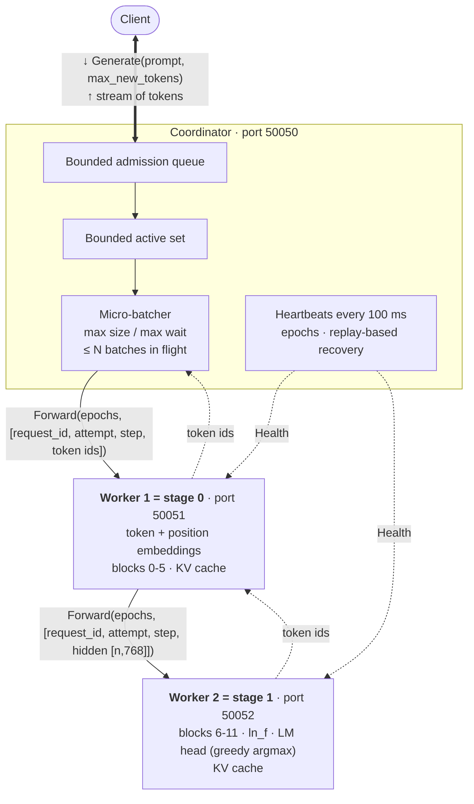
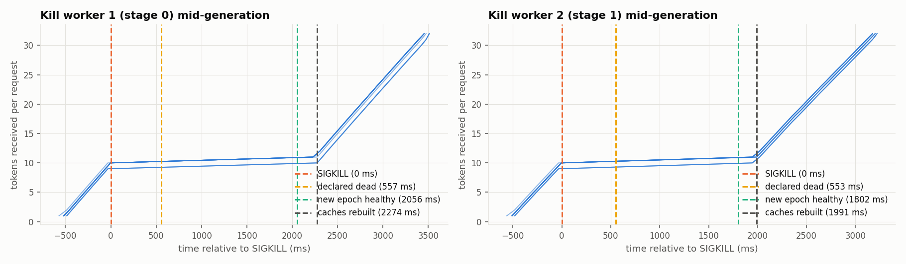
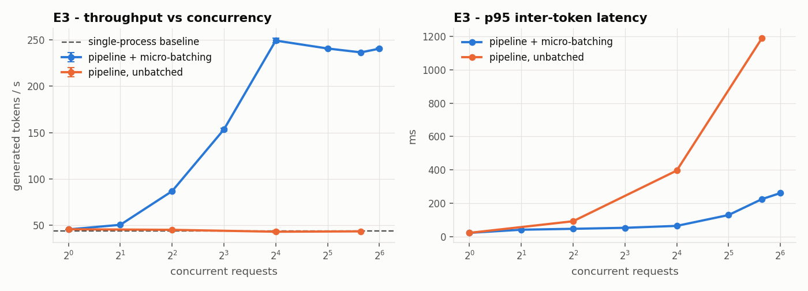
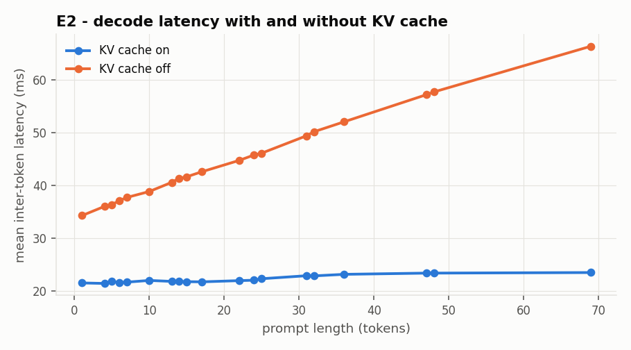

# Parallel LLM Inference

A pipeline-parallel inference system for GPT-2 small (124M). The model's 12 transformer blocks are split
across **two worker processes** that exchange activations over **gRPC**. A **coordinator** admits requests,
micro-batches and pipelines decode steps, keeps per-request KV caches consistent, and recovers from a worker
crash (SIGKILL) without returning stale, duplicate or wrong tokens. Correctness means token-for-token
agreement with single-process greedy decoding.

**Highlights** (measured on an 8-core Apple Silicon laptop, CPU only; details in [§6](#6-results)):
**100%** token-exact output in every experiment · **8.2×** throughput from micro-batching and pipelining
(44 → 359 tok/s) · **2.0×** faster decoding with the KV cache · **≈2.1 s** recovery from a worker SIGKILL with
**0** duplicate or lost tokens · overload rejected in **≈1 ms** with **0** hung requests.

* Objectives: `Parallel_LLM_Inference_Objectives.pdf`
* How the code is built, file by file: **[IMPLEMENTATION.md](IMPLEMENTATION.md)**
* What each file does and how data is processed inside it: **[CODE_WALKTHROUGH.md](CODE_WALKTHROUGH.md)**
* Benchmark numbers: `benchmarks/results/summary.md`, written by the benchmark command (§5)

---

## 1. Architecture



The thick two-way arrow is the client's `Generate` call and the token stream that comes back on it. Solid
arrows are `Forward` calls, and dotted arrows are replies and health checks.

Each decode step follows **Coordinator → Worker 1 → Worker 2 → Coordinator**. All three are separate OS
processes with their own ports. By default the coordinator spawns and supervises the two workers.

### Message protocol (`pllm/proto/pipeline.proto`)

| Message | Contents |
|---|---|
| `Tensor` | `shape`, `dtype`, raw little-endian `data` bytes (round trip is bit-exact) |
| `StageItem` | `request_id`, `step` (index of the token to produce), `attempt` (replay number), `reset` (prefill/replay), `use_cache`, `release_after`, then `token_ids` (stage 0) or `hidden` (stage 1) |
| `ForwardRequest` | `stage_epochs[]` (the epoch the sender believes each stage has), `batch_id`, `items[]` (one micro-batch) |
| `ForwardResponse` | per item: `status`, `token_id`, `replayed`; per stage: queue/compute/serialise/downstream ms and bytes |
| `Health` / `Release` / `Stats` / `Configure` | heartbeats, cache release, JSON stats, delay/compression injection |
| `CoordinatorService.Generate` | server-streaming: one chunk per token, then a final chunk with status `COMPLETED`, `OVERLOADED`, `TIMEOUT`, `CANCELLED`, `FAILED` or `INVALID` |

### Guarantees

* **Exact output.** Under greedy decoding, every completed response equals the single-process baseline
  token for token. This holds with or without the KV cache, at any micro-batch size, and across worker
  crashes.
* **Per-request ordering.** Tokens of a request are emitted strictly in step order, each exactly once. A
  request has at most one step in flight. A result is accepted only if its `(batch, attempt, step)` is the
  one the request is waiting for.
* **Overload.** When the admission queue is full, a request gets an immediate `OVERLOADED` final message: it
  is never silently dropped and never hangs. Coordinator queues, worker input queues and KV caches all have
  hard bounds, so memory stays flat under sustained overload.
* **Unrecoverable failure.** If a worker cannot be restarted, or a request cannot rebuild its state within
  `--recovery-deadline` (default 30 s), the request ends with an explicit `FAILED` status and a reason.
  `--request-timeout` gives `TIMEOUT`, and a client cancel gives `CANCELLED`. In every case the caches are
  released.

### Failure model and assumptions

* Crash-stop failures of worker processes, and dropped or delayed RPCs. Byzantine behaviour is out of scope.
* The coordinator is a single point of failure: it is not replicated.
* Detection: a worker is declared dead after `--failure-timeout` (default 0.6 s) without a successful
  heartbeat.
* Recovery:
  1. Restart the worker with a **higher epoch**, then discard everything stamped with the old epoch.
  2. Replay `prompt + generated tokens` under a new attempt number to rebuild both stages' KV caches.
  3. Continue generation.
* Messages are idempotent on `(request_id, attempt, step)`. A duplicate is answered from the stage's
  idempotency cache instead of being applied twice. Stale and out-of-order messages are rejected with an
  explicit status.

---

## 2. Setup

Requirements: Python 3.10+ (developed on 3.11) and an ordinary CPU (no GPU needed). The workers and
coordinator use about 0.4 GB of RAM each. The model download needs about 550 MB of disk.

```bash
cd Parallel-LLM-inference
python3 -m venv .venv
source .venv/bin/activate            # Windows: .venv\Scripts\activate
pip install -r requirements.txt
```

**Download GPT-2 once.** It goes to the Hugging Face cache. Every component also downloads it on first use,
but workers run with `HF_HUB_OFFLINE=1`, so fetch it before the first cluster run:

```bash
python -c "from pllm.model_loader import resolve_model_dir; print(resolve_model_dir())"
```

**Generate the reference outputs (O1).** Commit `reference_outputs.json`: the tests and benchmarks compare
against it.

```bash
python baseline.py            # 24 prompts x 32 greedy tokens -> reference_outputs.json
python baseline.py --check    # re-run; prints "re-run digest MATCHES" when the token sequences are byte-identical
```

The protobuf bindings in `pllm/proto/` are committed. Regenerate them only after editing the `.proto` file:
`bash scripts/gen_proto.sh`.

Optional environment variables:

* `PLLM_THREADS`: torch threads per process, default 4. The baseline and the workers must use the same
  value, so recreate the reference if you change it.
* `PLLM_MODEL`: Hub ID or local directory of a GPT-2 checkpoint.

---

## 3. Running the system

```bash
# Terminal 1: coordinator on :50050; it spawns worker 1 (:50051) and worker 2 (:50052)
python -m pllm.coordinator

# Terminal 2: stream a generation
python -m pllm.client --prompt "The capital of France is" --max-new-tokens 20
python -m pllm.client --stats          # coordinator and worker stats (queues, epochs, utilisation, bytes, RSS)
```

Useful coordinator flags (`python -m pllm.coordinator --help` lists them all):

| Flag | Default | Meaning |
|---|---|---|
| `--max-batch-size`, `--max-wait-ms` | 8, 2 | micro-batch size, and how long to wait for it to fill |
| `--max-inflight` | 2 | micro-batches in the pipeline at once; `1` disables pipelining |
| `--no-kv-cache` | off | recompute the full sequence every step |
| `--admission-queue`, `--max-active` | 64, 64 | backpressure bounds |
| `--split` | `6` | layer boundary; `--num-stages 3 --split 4,8` or `--split auto` for N stages |
| `--failure-timeout`, `--heartbeat-interval` | 0.6 s, 0.1 s | failure detection |
| `--recovery-deadline`, `--request-timeout` | 30 s, 300 s | explicit failure / timeout |
| `--activation-dtype float16` | float32 | compressed activations (lossy, stretch goal) |
| `--duplicate-dispatch` | off | fault injection: send every micro-batch twice |

**Workers on two machines.** Start the workers yourself, then point the coordinator at them:

```bash
# machine B
python -m pllm.worker --stage 1 --port 50052 --host 0.0.0.0
# machine A
python -m pllm.worker --stage 0 --port 50051 --host 0.0.0.0 --next-addr B:50052
python -m pllm.coordinator --worker-addrs A:50051,B:50052
```

In this mode each worker's epoch defaults to its start time in milliseconds. If you restart a crashed
worker (by hand or with systemd), it comes back with a higher epoch, and the coordinator detects this and
replays.

**Demo** (O9: normal generation, overload, and a worker kill with recovery, in one terminal):

```bash
bash scripts/demo.sh                                       # PYTHON=python bash scripts/demo.sh outside .venv
asciinema rec demo.cast -c "bash scripts/demo.sh"          # optional: record it
```

---

## 4. Tests

```bash
pytest -m "not slow" -s     # unit tests: baseline, partition, serialisation, KV cache, ordering, epochs (~1-2 min)
pytest -m slow -s           # end-to-end over real processes: 50 concurrent, kills, overload, ... (~3-5 min)
pytest                      # everything
```

| Test file | Checks |
|---|---|
| `tests/test_baseline.py` | reference file complete; re-run byte-identical (O1) |
| `tests/test_partition.py` | split vs full logits ≤ 1e-5 and identical greedy tokens; other splits (3 and 4 stages, auto); each stage holds its share of the weights (O2) |
| `tests/test_serialization.py` | bit-exact tensor round trip, including NaN, ±inf, -0.0, bf16 and non-contiguous tensors (O3) |
| `tests/test_kv_cache.py` | cache on = off = reference; cache is faster; interleaved requests never mix; mixed prefill/decode batches; out-of-order, stale and duplicate steps; replay attempts; epochs; release; capacity and TTL (O4, O7) |
| `tests/test_distributed.py` | gRPC end to end: all prompts exact; 50 concurrent exact with bounded queues; cancel frees caches; timeout; SIGKILL of either worker → exact output; stale-epoch injection rejected; duplicate dispatch → no duplicate tokens; overload → explicit rejections; KV cache off over RPC (O3, O5, O7) |

---

## 5. Experiments: setup and commands

**One command runs every benchmark and regenerates every plot (O8):**

```bash
python -m benchmarks.run_all            # all experiments, 3 repetitions each (roughly 30-40 min on a laptop CPU)
python -m benchmarks.run_all --quick    # 1 repetition, fewer sweep points (roughly 10 min)
python -m benchmarks.plots              # only rebuild plots + summary.md from existing results
```

**Where results go:**

* raw CSV and JSON: `benchmarks/results/`;
* plots: `benchmarks/plots/*.png`;
* the numbers table: `benchmarks/results/summary.md`.

**Before you run anything:**

* Every experiment needs §2 completed: dependencies installed, the model downloaded, and
  `reference_outputs.json` generated.
* Each experiment starts its own cluster on ports **50400-50480**, so it will not clash with a coordinator
  you run by hand on 50050. Close other CPU-heavy programs: the benchmarks measure latency.
* To run a single experiment, use `--only <key>`. Keys can be combined, for example
  `python -m benchmarks.run_all --only e1,e2 --reps 3`.

| # | Scenario | Command | Extra setup | Output |
|---|---|---|---|---|
| E1 | Single request, distributed vs baseline | `python -m benchmarks.run_all --only e1` | none; also runs the in-process baseline and the split-without-RPC variant | `baseline.csv`, `e1_single_request.csv`, `plots/e1_latency.png` |
| E2 | KV cache on vs off | `python -m benchmarks.run_all --only e2` | none; starts a cluster with and without `--no-kv-cache` | `e2_kv_cache.csv`, `plots/e2_kv_cache.png` |
| E3 | 1 to 64 concurrent requests | `python -m benchmarks.run_all --only baseline,e3` | admission queue 128 / max active 64, so nothing is rejected | `e3_concurrency.csv`, `plots/e3_throughput_vs_concurrency.png` |
| E4 | Batch size sweep 1, 2, 4, 8, 16, with and without pipelining | `python -m benchmarks.run_all --only e4` | 32 concurrent requests; 10 cluster configurations | `e4_batch_sweep.csv`, `plots/e4_batch_sweep.png`, `plots/bottleneck_breakdown.png` |
| E5 | Overload beyond queue capacity | `python scripts/load_test.py --plot` (or `--only e5`) | its own cluster with admission queue 16 / max active 16; 400 requests offered at 40 req/s. `--addr host:port` targets a running coordinator instead | `e5_overload_timeseries.csv`, `e5_overload_summary.json`, `plots/e5_overload.png` |
| E6 | Kill Worker 1 (stage 0) mid-generation | `python scripts/fault_inject.py kill --stage 0 --reps 3 --plot` | 12 concurrent requests; SIGKILL after 30% of tokens (`--kill-at`) | `e6_e7_recovery.csv`, `e6_e7_timeline.csv`, `plots/e6_e7_recovery_timeline.png` |
| E7 | Kill Worker 2 (stage 1) mid-generation | `python scripts/fault_inject.py kill --stage 1 --reps 3 --plot` | as for E6. `--only e6` in `run_all` runs E6 and E7 | same files as E6 |
| E8 | Stale-epoch and duplicate messages | `python scripts/fault_inject.py stale` (or `--only e8`) | crashes stage 1, then (a) injects a pre-crash-epoch message into the restarted pipeline, (b) delivers every step twice straight to the workers, (c) runs a `--duplicate-dispatch` cluster | `e6_e8_fault_summary.json` |
| E9 | Artificial network delay between workers | `python -m benchmarks.run_all --only e9` | delay set at run time through the worker `Configure` RPC (0 to 20 ms one-way on stage 0 → stage 1), with 1 and 4 batches in flight. By hand: `--link-delay-ms` on `pllm.worker` | `e9_network_delay.csv`, `plots/e9_network_delay.png` |
| - | Prompt-length sweep (O8) | `python -m benchmarks.run_all --only plen` | synthetic prompts of 8, 64, 256 and 512 tokens; references computed on the fly by the baseline | `prompt_length.csv`, `plots/prompt_length_ttft.png` |
| - | fp16 activation compression (stretch) | `python -m benchmarks.run_all --only fp16` | none | `fp16_compression.csv` |

**Metrics reported (Section 5 of the objectives):**

* time to first token, and inter-token latency (mean, p50, p95, p99), both measured at the client;
* throughput (tokens/s);
* activation and wire bytes per token and per request;
* utilisation of each stage (busy compute time divided by wall time);
* rejection rate;
* recovery time, split into detection, restart and replay;
* correctness: the share of responses that match the reference exactly.

`summary.md` also splits a pipeline step into compute, (de)serialisation, queueing and RPC/network
overhead. That split shows where the bottleneck is.

## 6. Results

**Test machine:** Apple Silicon (arm64), 8 CPUs, macOS, Python 3.11.9, torch 2.11.0, 4 torch threads per
process, no GPU. Every configuration ran 3 times, and the values are means. All three processes ran on the
same machine, so the "network" is loopback. The full tables are in `benchmarks/results/summary.md`, and
`python -m benchmarks.run_all` regenerates them.

### Headline numbers

| What | Result | Experiment |
|---|---|---|
| Correctness | **100%** of responses token-exact against the single-process baseline, in every experiment | all |
| Distributed overhead | **+2.89 ms** per decoded token (25.2 vs 22.3 ms, 1.13×); about 5 KB on the wire per token | E1 |
| KV cache | **2.00×** faster decoding (44.4 → 22.2 ms per token) | E2 |
| Throughput | **359 tok/s** at batch 16 with pipelining: **8.2×** the unbatched, unpipelined pipeline (43.8 tok/s) | E4 |
| Concurrency | 45 → 249 tok/s from 1 to 16 concurrent requests, flat afterwards at the default batch cap of 8 | E3 |
| Crash recovery | **2.20 s** (worker 1) and **2.10 s** (worker 2) mean; 72/72 responses exact, **0** duplicate, **0** missing tokens | E6, E7 |
| Overload | 400 requests at 40 req/s: 96 completed (all exact), 304 rejected in **≈1 ms**, **0** hung, queues within bounds | E5 |
| Stale and duplicate messages | every stale-epoch message rejected; 505 duplicate results discarded, **0** duplicate tokens emitted | E8 |
| fp16 activations | half the bytes per token (5068 → 2568 B) with 100% token accuracy | stretch |

### Findings

* **The system is compute-bound.** In a pipeline step, compute takes 93-97% of the time, (de)serialisation
  under 0.5%, and RPC/network/event-loop overhead 3-7%. Shrinking activations (fp16) therefore does not
  change latency on one machine.
* **Stage 1 is the bottleneck stage.** With pipelining, stage 1 runs at 96-99% utilisation and stage 0 at
  68-81%. Stage 1 also computes `ln_f` and the LM head, a 768 × 50257 matrix multiply.
* **Pipelining hides network delay.** With 20 ms of added one-way delay between the workers, throughput at
  32 concurrent requests falls 34% (180 → 119 tok/s) with 1 batch in flight, but stays flat (242 → 238 tok/s)
  with 4 in flight.
* **Recovery time is mostly process restart.** Of the ≈2.1 s, detection takes ≈0.56 s (the 0.6 s failure
  timeout), restarting the worker and loading its weights ≈1.4 s, and replaying the KV caches ≈0.2 s. A warm
  standby worker would remove most of the restart time.

### Plots

**Recovery after a worker SIGKILL (E6, E7)**



**Throughput vs concurrency (E3)**



**KV cache on vs off (E2)**



The other plots are in `benchmarks/plots/`.

## 7. Design decisions and trade-offs (short version)

Full discussion: [IMPLEMENTATION.md §11](IMPLEMENTATION.md#11-design-decisions-trade-offs-and-what-was-left-out).

* **Selective batching.** Row-wise operations run as one large matrix multiply over every request in the
  batch; attention runs per request against that request's own cache. This means no padding, batched output
  is identical to unbatched output, and prefill and decode can share a batch.
* **One compute thread per worker.** It serialises KV-cache updates without locks. Stage 0 hands batch k to
  stage 1 and immediately starts batch k+1, so the stages overlap. Heartbeats stay responsive throughout.
* **Workers load only their own tensors** from `model.safetensors`. Because GPT-2 ties its embedding and LM
  head, both stages need the 147 MiB embedding matrix, so each stage holds about 2/3 of the checkpoint
  rather than 1/2. The transformer blocks are split exactly in half.
* **Recovery replays prompt + generated tokens through both stages** under a new attempt number. This is
  simple and always correct, at the cost of recomputing the surviving stage's cache.
* **Left out:**
  * sampling and EOS early stopping;
  * tensor parallelism;
  * GPU support;
  * authentication;
  * chunked prefill;
  * coordinator replication;
  * other model architectures (TinyLlama, Qwen).
